# Diseño y desarrollo de la solución

Tomi-Alert es una aplicación de dos paneles y una sola base. El visitante entra con un documento y una contraseña. Si el rol es administración, cae en `/admin`. Si el rol es alumno, cae en `/alumno`. No hay una pantalla intermedia para elegir el perfil. El documento decide.

La pantalla de ingreso pide DNI o pasaporte, y contraseña. No muestra atajos con usuarios de prueba. Esos datos viven en esta memoria, en el anexo de la defensa, porque en una mesa de examen alcanzan para repetir el recorrido, pero no tienen que quedar pintados en el producto.

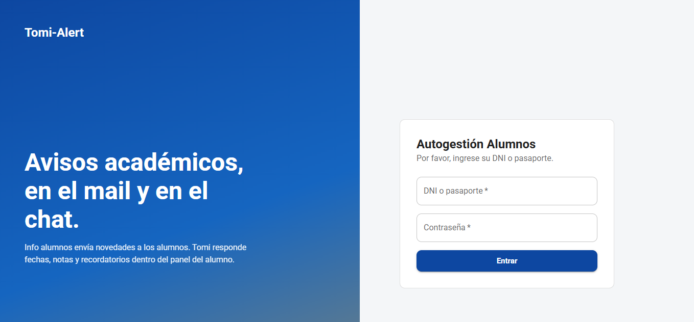

## Lo que ve administración

El inicio no es una grilla de números sueltos. Pregunta qué se va a hacer hoy y ofrece las tareas del panel: mesas y parciales, horarios y aulas, avisos, notas, envíos y recordatorios de mesa. Debajo, un bloque de “para tener en cuenta” resume el estado del panel y cuatro casos que la defensa necesita tener a mano. Esos casos no reemplazan el manual. Evitan que, el día del examen, haya que recordar de memoria quién tiene el mail apagado.

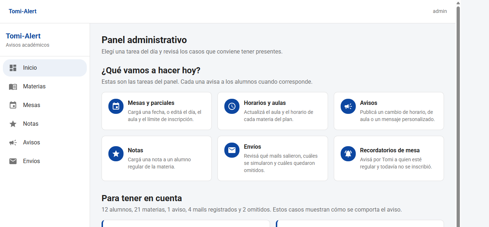

Materias muestra el plan de la tecnicatura. No se inventan materias nuevas desde la pantalla: el plan está sembrado. Lo que sí se edita es el aula y el horario, y la inscripción de cada alumno, con estado cursando o regular y, si está regular, si ya figura inscripto a la mesa. El buscador de alumnos pide al menos dos letras. Con cien alumnos, un desplegable completo deja de ser una herramienta.

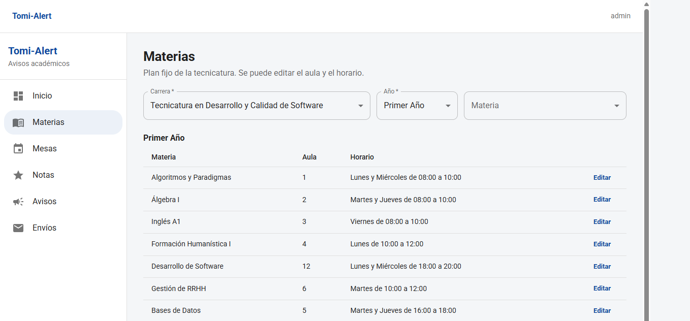

Mesas y parciales concentra las fechas. Cada registro tiene materia, tipo (Final o Parcial), fecha, límite de inscripción y aula. Crear, editar o borrar no es un cambio silencioso. El sistema avisa a los alumnos de esa materia, por mail y por Tomi, con la información nueva o con la cancelación. En la tabla, el tipo se muestra con la primera letra en mayúscula. En la base sigue guardado en minúscula, porque es un código, no un título.

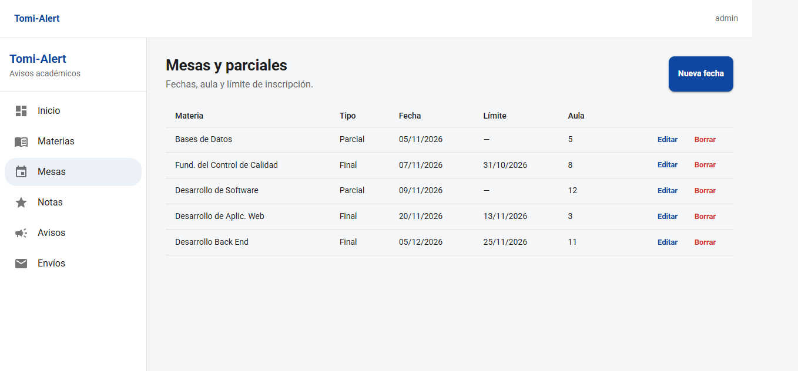

Notas pide carrera, año, materia, un alumno regular, la instancia y la nota. La instancia puede ser Parcial, Recuperatorio o Final. La nota se rechaza si no está entre 0 y 10. No se ofrece un alumno que todavía está cursando: la instancia de nota, en este MVP, corresponde a quien ya regularizó. Al cargar, salen el mail y el mensaje de Tomi, según las preferencias, y el envío queda en el registro. La tabla muestra por defecto las últimas notas y se puede filtrar por alumno, legajo o materia.

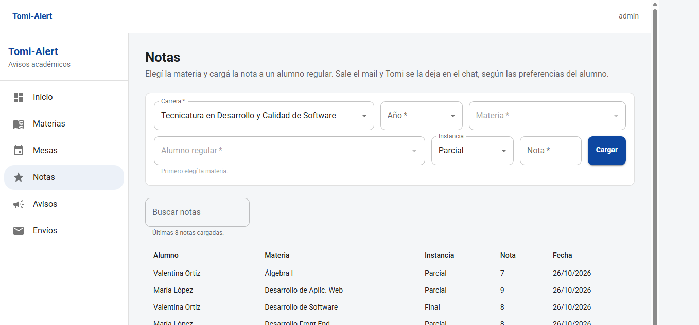

Avisos tiene tres tipos: horario, aula y personalizado. El texto de la pantalla lo dice con claridad, porque las notas no se publican ahí. Un aviso de materia llega a los inscriptos. Uno personalizado llega a la lista elegida. Reenviar un aviso vuelve a intentar el correo y no reescribe el chat: el mensaje de Tomi ya se dejó la primera vez.

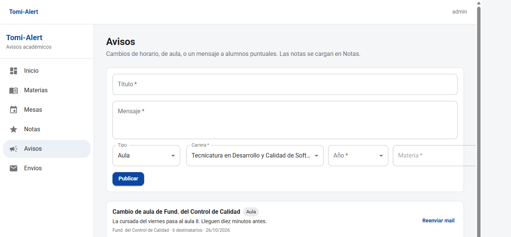

Envíos es la prueba de que el canal se respetó. Cada fila tiene fecha, asunto, alumno, estado y detalle. El estado puede ser enviado, simulado, omitido o error. Simulado aparece cuando el entorno no sale de verdad por SMTP, o cuando el registro de demostración se cargó así. Omitido aparece cuando el alumno desactivó el mail. El filtro se hace en el servidor, no en el navegador: estado, alumno, un texto de asunto o detalle, y un rango de fechas. Si más adelante hay miles de filas, la pantalla sigue pidiendo una página de cincuenta y no el archivo completo.

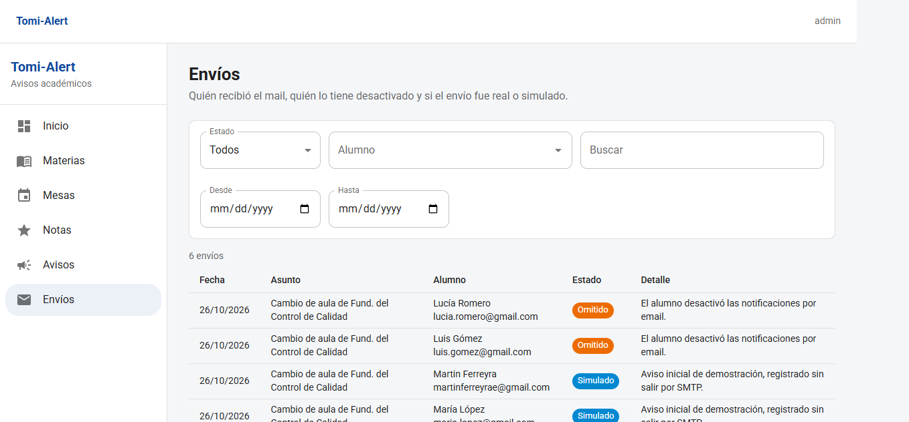

## Lo que ve el alumno

El alumno entra y ve sus materias: nombre, estado, aula, horario y, si está regular, si ya figura inscripto a la mesa. No ve el plan entero. Ve lo suyo.

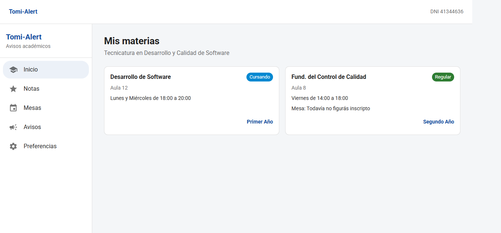

En Notas ve la instancia, el valor y la fecha. En Parciales y mesas ve la materia, el tipo, la fecha, el límite y el aula de las materias en las que está inscripto a la cursada. Esa lista no se esconde si todavía no se anotó a la mesa: la tarjeta de inicio es la que dice “todavía no figurás inscripto”. La fecha se muestra igual, porque el dato existe. En Avisos ve lo que le publicaron. En Preferencias apaga o enciende el mail y los mensajes de Tomi. Apagar el mail no esconde el aviso del panel. Apagar Tomi no borra el correo. Son dos llaves distintas.

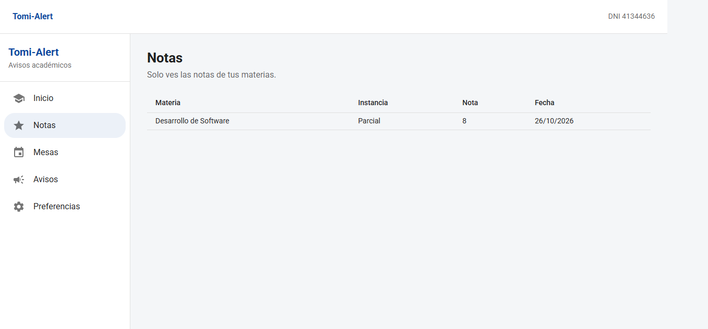

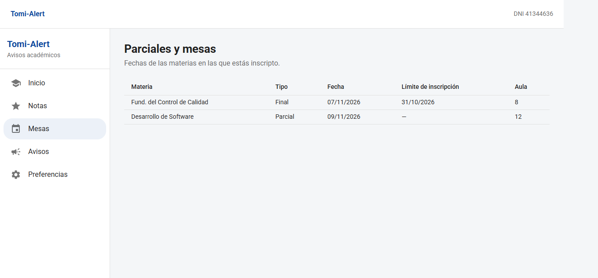

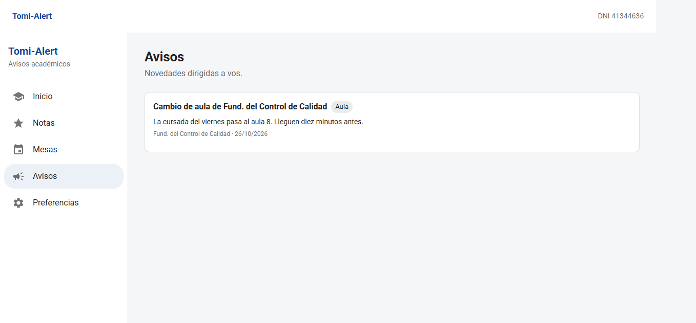

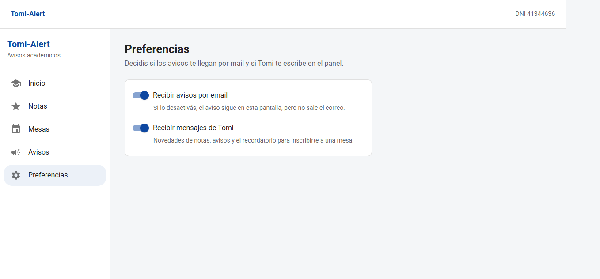

Tomi está en un botón del panel. Las respuestas rápidas cubren parciales, finales, notas, horarios, aulas e inscripción. El alumno también puede escribir con sus palabras. “Qué nota tengo en desarrollo de software” tiene que devolver el parcial cargado. “Notas de fund. del control de calidad”, si esa nota no existe, tiene que decir que no hay nota, no inventar un número.

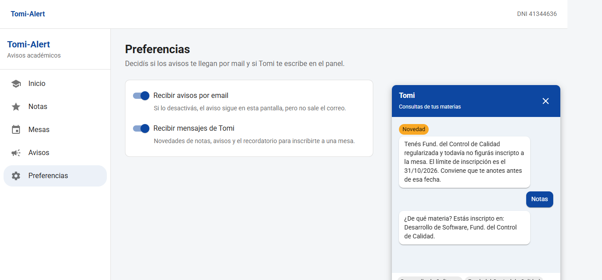

## Decisiones de diseño que se notan en el uso

La primera decisión fue no mezclar los avisos con las notas. Un aviso es una novedad de cursada o un mensaje. Una nota es una calificación. Si las dos salen por el mismo formulario, en la defensa no se puede explicar por qué una nota “se publicó”. Por eso Notas y Avisos son pantallas distintas, aunque las dos terminen en un mail y en un mensaje de Tomi.

La segunda fue mostrar el tipo Final o Parcial con mayúscula, y guardar el código en minúscula. Lo mismo pasa con Cursando y Regular. La interfaz habla en castellano. La base habla en códigos cortos, que las pruebas pueden comparar sin depender de una tilde.

La tercera fue el buscador de alumnos. Un select con todos los nombres sirve con doce personas y se rompe con cien. El componente pide dos letras, ignora acentos y muestra como máximo ocho coincidencias. Ese mismo criterio se usa al inscribir y al cargar una nota.

La cuarta fue el filtro de envíos en el servidor. Filtrar en el navegador, después de bajar las últimas doscientas filas, esconde justamente los envíos viejos que uno estaba buscando. El pedido lleva estado, alumno, texto y fechas. La respuesta trae la página y el total.

La quinta fue sacar del login los botones de demostración. Quedaban bien para desarrollar y mal para una entrega. Las credenciales están en el anexo, no en la pantalla.
