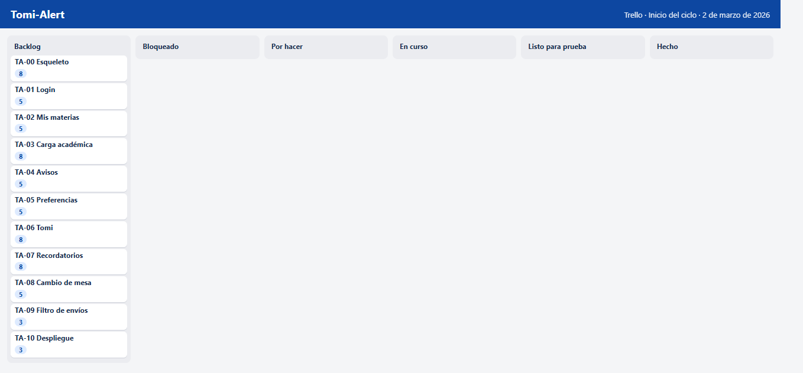
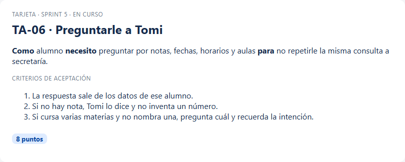

# Planificación

El trabajo se planificó el 2 de marzo de 2026 y se cerró el 19 de junio. Cada sprint duró dos semanas, de lunes a viernes. El tablero fue Trello. Las columnas, de izquierda a derecha, fueron Backlog, Bloqueado, Por hacer, En curso, Listo para prueba y Hecho. Una tarjeta no salta de Backlog a Hecho. Pasa por el curso y por la prueba. Si la prueba del recorrido falla, vuelve.

Las figuras del tablero son una reconstrucción. Conservan las columnas, los códigos y los puntos con los que se trabajó, y muestran el estado al inicio y al cierre de cada sprint. No son una exportación automática de Trello: se armaron para esta memoria, porque el tablero real no se iba a poder abrir dentro del documento. El contenido de cada tarjeta sí es el de la historia. Una tarjeta de más, cuando aparece, es un arrastre con nombre propio, por ejemplo el pulido del marco o el aviso al cambiar una mesa, y sus puntos son los del carry over de ese cierre.

Cada tarjeta lleva un código, la historia en la forma “como / necesito / para”, una descripción corta, los criterios de aceptación y los story points. La escala usada es 1, 2, 3, 5 y 8. No se usó el 13. Una historia de 13 puntos, para una sola persona, es una historia que todavía no está cortada.

## Épicas

Hubo cuatro épicas.

Acceso. Entrar con documento, separar administración de alumno y no mostrar datos de un rol en el panel del otro.

Académico. Materias, inscripciones, mesas, notas y las pantallas del alumno para mirar lo propio.

Comunicación. Avisos, correo, preferencias, registro de envíos y el aviso cuando una fecha de mesa cambia.

Tomi. Consultas, recordatorios de mesa y el mensaje que acompaña a una nota o a un aviso, siempre condicionado por la preferencia.

El despliegue no fue una épica de producto. Fue una historia de cierre, TA-10, para dejar escrito dónde va cada capa cuando el trabajo salga del entorno local.

## Historias de usuario

Los puntos de las historias de producto suman 52. El resto de la capacidad de cada sprint se usó en tareas de la misma historia: modelo, pruebas, semillas de datos y ajustes de pantalla. Esas tareas no tienen tarjeta propia para no duplicar el tablero. El sprint las cuenta dentro del número planificado.

TA-01. Como visitante necesito iniciar sesión con DNI o pasaporte para entrar al panel de mi rol. La administración entra con el usuario admin. 5 puntos. Criterios: una credencial inválida muestra error y no entra; admin abre `/admin`; un alumno abre `/alumno`.

TA-02. Como alumno necesito ver mis materias, el horario y el aula. 5 puntos. Criterios: solo aparecen materias en las que estoy inscripto; se distingue cursando de regular; si estoy regular, veo si ya figuro inscripto a la mesa.

TA-03. Como administración necesito mantener el aula, el horario, las inscripciones, las mesas y las notas. 8 puntos. Criterios: una nota fuera de 0 a 10 se rechaza; no se carga una nota a quien no está regular; el buscador de alumnos no lista a todos de entrada.

TA-04. Como administración necesito publicar un aviso de horario, de aula o un mensaje personalizado. 5 puntos. Criterios: el aviso de una materia lo ven sus inscriptos; un alumno de otra materia no lo ve; las notas no se cargan en esta pantalla.

TA-05. Como alumno necesito activar o desactivar el mail y los mensajes de Tomi. 5 puntos. Criterios: con el mail apagado el envío queda omitido y el aviso igual se ve en el panel; con Tomi apagado no llega el mensaje de chat.

TA-06. Como alumno necesito preguntarle a Tomi por notas, fechas, horarios y aulas. 8 puntos. Criterios: la respuesta sale de mis datos; si no hay nota, Tomi lo dice; si curso varias materias y no nombro una, pregunta cuál y recuerda la pregunta.

TA-07. Como alumno necesito que Tomi me avise cuando hay una novedad o cuando se acerca el límite de una mesa que tengo regularizada y no estoy inscripto. 8 puntos. Criterios: el recordatorio de esa mesa no se repite; si Tomi está desactivado, no llega; el plazo es de siete días.

TA-08. Como alumno necesito enterarme si crean, cambian o borran una mesa o un parcial de una materia mía. 5 puntos. Criterios: el mensaje trae la información nueva, o la cancelación; el mail respeta la preferencia; el envío queda en Envíos.

TA-09. Como administración necesito filtrar los envíos por estado, alumno, texto y fecha. 3 puntos. Criterios: el filtro corre en el servidor; Omitido no mezcla filas enviadas; si no hay coincidencias, la tabla lo dice.

TA-10. Como equipo necesito dejar documentado el destino de publicación del front, de la API y de la base. 3 puntos. Criterios: el front queda descrito para Vercel, la API para Render y la base para Atlas; queda escrito por qué no se usa Heroku.

## Criterios de aceptación

Un criterio no es un deseo. Es una frase que se puede mostrar. “El sistema es usable” no es un criterio. “Luis Gómez aparece en Envíos con estado Omitido después del aviso de Fundamentos del Control de Calidad” sí lo es. Por eso las historias de arriba se escribieron con nombres del seed y no con “un usuario cualquiera”.

La prueba de una historia de Tomi tiene dos capas. La primera es automática: el motor, con la frase y el contexto, devuelve el texto esperado. La segunda es manual: la misma frase, escrita en el chat del panel, muestra ese texto. Si solo pasa una de las dos, la tarjeta se queda en Listo para prueba.

## Story points

La escala es la de Fibonacci cortada en 8. Un 1 es un ajuste de texto. Un 2 o un 3 es una pantalla que ya tiene modelo. Un 5 cruza dos capas, por ejemplo la preferencia y el registro del mail. Un 8 cruza reglas, datos del alumno y una conversación de más de un turno. TA-06 y TA-07 están en 8 por eso, no porque el chat “se vea grande”.

No se estimó en horas. Con una sola persona, la hora miente: una tarde de interfaz puede no mover una historia, y una mañana de pruebas puede cerrarla. El punto mide incertidumbre, no reloj.

## Definición de hecho

Una tarjeta pasa a Hecho cuando se cumplen las cuatro condiciones, no cuando el código compila.

La primera es el criterio de aceptación, escrito antes de la review, con un dato que se puede señalar. “Funciona el mail” no alcanza. “Luis Gómez queda omitido y Martin queda simulado o enviado” sí.

La segunda es el lugar donde se muestra. Una historia de pantalla se muestra en la pantalla. Una historia de Tomi se muestra en el chat y, además, en la prueba automática que fija la frase. Si solo pasa una de las dos, la tarjeta se queda en Listo para prueba.

La tercera es el registro. Si la historia toca el correo, tiene que haber una fila en Envíos para el que recibió y para el que no. Si la historia toca el chat proactivo, el mensaje está en el hilo y no se duplica al repetir la acción. El recordatorio de mesa no crea fila de correo. Esa ausencia también es parte del criterio, y está dicha para que nadie busque en Envíos un mensaje que vive solo en el chat.

La cuarta es el alcance. La tarjeta no se agranda el viernes para incluir la idea que apareció el jueves. Esa idea va a Backlog o se descarta. Recuperar la contraseña, la aplicación móvil y el modelo de lenguaje se descartaron de este ciclo. Quedaron en el trabajo futuro, no en una tarjeta a medio hacer.

El carry over es la forma honesta de no cumplir la cuarta a escondidas. Si el viernes el criterio no se puede mostrar, la tarjeta no está hecha y sus puntos pasan. El sprint 1 dejó el marco. Del sprint 2 al 5 quedó abierto el aviso al cambiar una mesa, hasta que el sprint 6 lo cerró junto con el filtro. Marcarlos hechos en el sprint en que se desearon habría dejado la tabla de velocidad en una recta, y la recta no es lo que pasó.

## Presupuesto del proyecto

El presupuesto es ilustrativo. No es una cotización ni un gasto rendido. Sirve para ubicar el trabajo en el orden de magnitud que la materia pide.

Se toma un perfil fullstack junior durante cuatro meses, de marzo a junio de 2026, que es la ventana real de los sprints. En un mercado local de referencia académica, ese perfil se puede pensar en el orden de un jornal junior de dedicación parcial, compatible con seguir cursando. No se publica un monto cerrado porque el documento no acompaña recibos y un número inventado con precisión de pesos quedaría peor que la estimación cualitativa.

Las herramientas de gestión y de publicación se eligieron para que el costo de práctica sea cero o el plan gratuito del servicio. Trello, en el uso que hizo este proyecto, no exige un plan pago. GitHub aloja el repositorio. MongoDB Atlas tiene un cluster compartido suficiente para la demostración. Vercel tiene un plan hobby para el front. Render tiene un plan gratuito con las limitaciones conocidas de suspensión por inactividad, aceptables para una defensa y no para una secretaría en producción. Heroku se descartó: el producto sigue existiendo, pero el dyno gratuito se retiró en 2022 y el plan más bajo es pago. Para una tesis, pagar un dyno no agrega nada que Render no resuelva.

El correo de práctica usa una cuenta de Gmail dedicada, `infoalumnosunsta@gmail.com`, con una contraseña de aplicación. Esa contraseña no se transcribe en esta memoria. Vive en el entorno del servidor.

Si el mismo producto se contratara afuera, el costo dominante no sería el hosting. Sería el tiempo de la persona que cubre los tres roles. El hosting, en el recorte de este MVP, es la parte barata.
