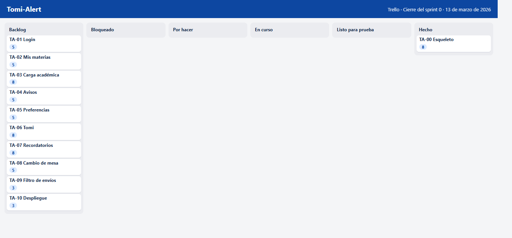
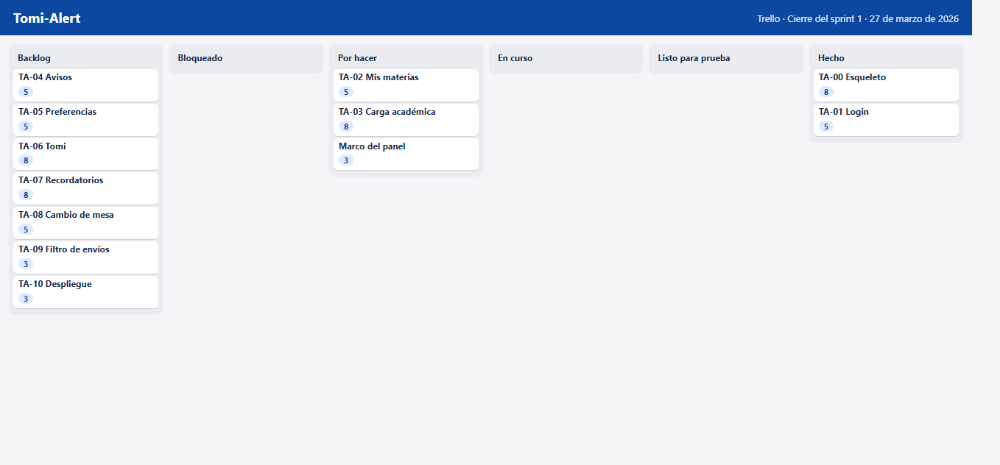
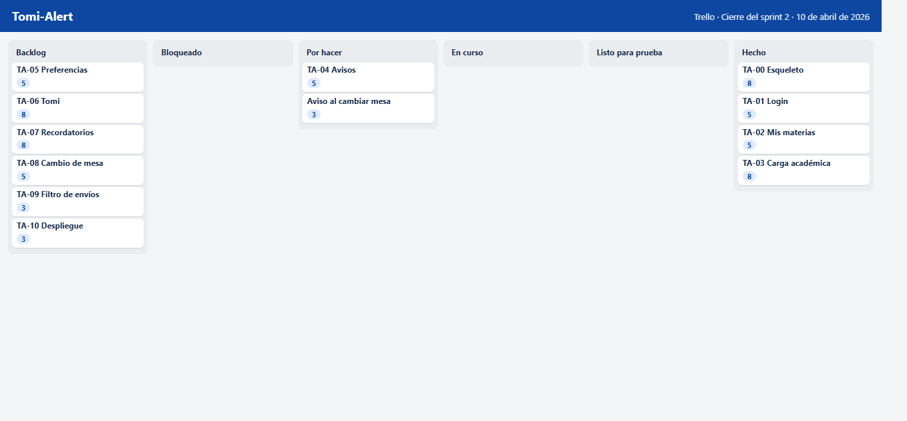
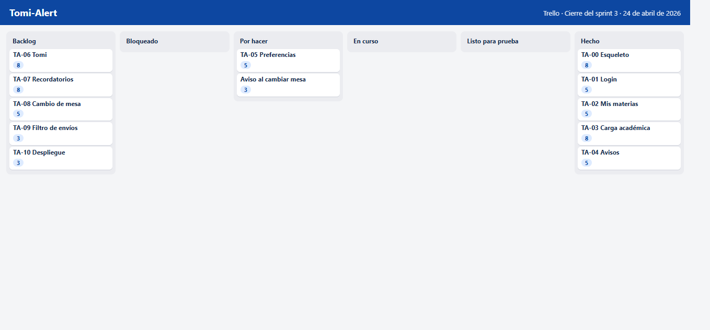
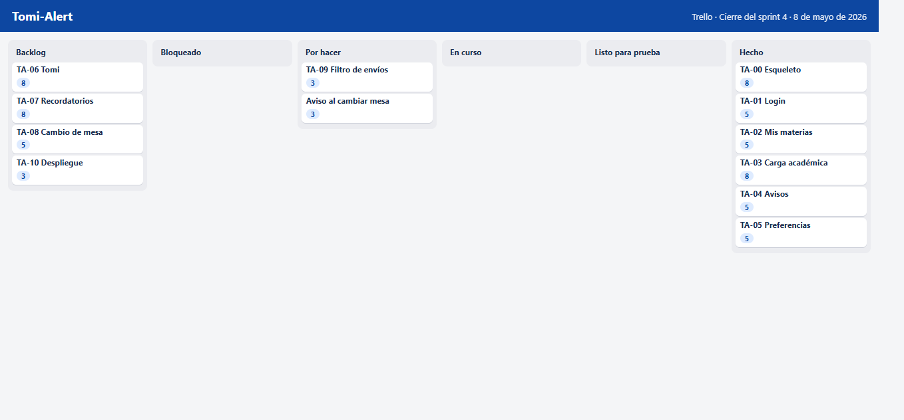
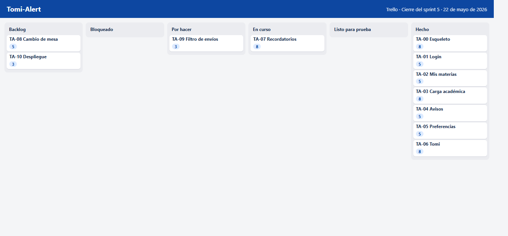
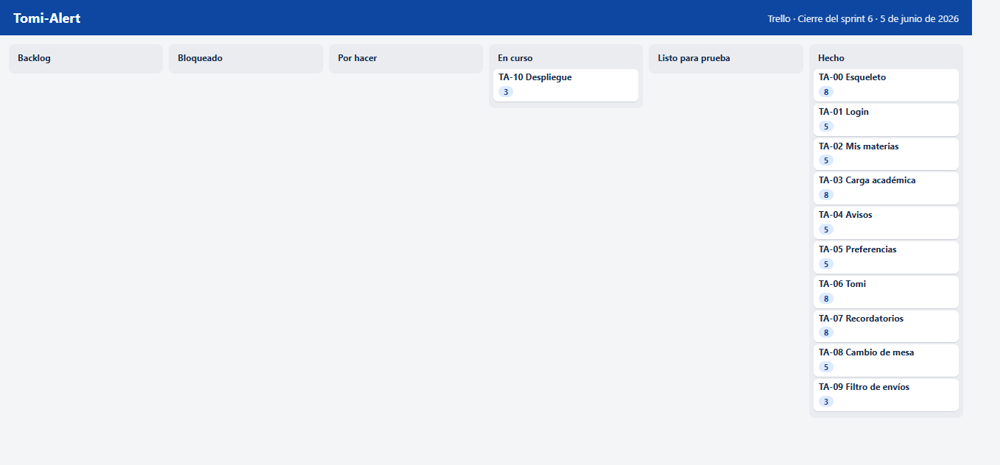
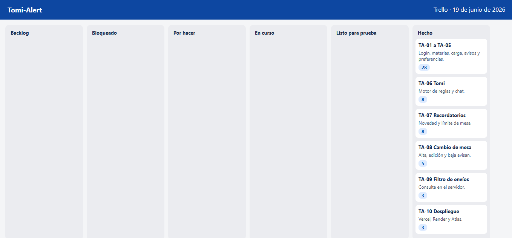

# Ejecución

Cada sprint se cierra con el mismo esquema: qué se quería, qué pasó con el tablero, qué quedó usable y qué se anotó para el siguiente. Las fechas son las del calendario de trabajo, de marzo a junio de 2026. De julio a octubre no hubo sprint de producto. Hubo revisión de esta memoria.

La semana no se partió en ceremonias largas. El lunes se miraba el tablero y se decidía qué entraba, contando el arrastre. De martes a jueves se construía y se probaba el criterio de la tarjeta que estaba en curso, no el del sprint entero. El viernes se movía a Hecho solo lo que se podía mostrar, se anotaba el carry over y se escribía la retrospectiva en pocas líneas. No hubo daily de pie. Con una sola persona, la daily es el tablero abierto al empezar.

Una tarjeta pasa por Por hacer, En curso y Listo para prueba antes de Hecho. Listo para prueba significa que el criterio está escrito y el recorrido todavía no se mostró. Si el recorrido falla, la tarjeta vuelve. No se cierra “con observaciones”. Las figuras de este capítulo muestran el tablero al cierre de cada sprint, reconstruido con las mismas columnas.

## Sprint 0. Del 2 al 13 de marzo

El objetivo era tener un lugar donde pararse: repositorio, modelo, semilla de datos y la decisión de que Tomi no iba a ser un modelo de lenguaje. Se planificaron 8 puntos. Se completaron 8. No hubo carry over.

En el tablero, las tarjetas de producto seguían en Backlog. En En curso estaban el esqueleto del monorepo y la semilla. El monorepo tiene un cliente y un servidor. El servidor se puede arrancar solo. La raíz puede levantar los dos con un solo comando, cuando la herramienta de concurrencia está instalada.

La semilla carga la tecnicatura, el plan de tres años, doce alumnos y un conjunto de inscripciones que intenta parecerse a una carrera en marcha. Juan Díaz cursa todo primer año. Valentina Ortiz regularizó primero y cursa segundo. Facundo Molina regularizó primero y segundo, y cursa tercero, con las mesas de segundo todavía abiertas. María López está en tercero y arrastra materias de segundo. El resto cursa un tramo, no el año completo. Martin, Luis y María quedan marcados para la defensa: mail y Tomi activos, mail apagado, y Tomi apagado, en ese orden.

La retrospectiva fue corta. El seed, al principio, apuntaba a correos viejos y a una alumna que ya no estaba en la lista. Se corrigió antes de construir pantallas encima. También quedó anotado que el proceso de desarrollo, al vigilar toda la carpeta del servidor, se reiniciaba cuando una librería de codificación cargaba un archivo por primera vez. Ese reinicio cortaba el primer pedido después del login. Se resolvió más adelante, limitando la vigilancia a la carpeta de código. En el sprint 0 alcanzó con dejarlo escrito para no confundirlo con un error de negocio.

## Sprint 1. Del 16 al 27 de marzo

El objetivo era entrar y caer en el panel correcto. Planificado: 13. Completado: 10. Carry over: 3, el pulido del marco de navegación, que pasó al sprint 2.

TA-01 se cerró. El login distingue documento y contraseña. Una credencial mala no abre nada. Administración entra a `/admin`. Un alumno entra a `/alumno`. El token se pide en las rutas protegidas.

El marco, con el menú lateral, el nombre de quien está adentro y el cierre de sesión, quedó usable pero todavía incómodo en pantallas chicas. Esos 3 puntos no se marcaron hechos. En la review se mostró el ingreso de Martin y el de administración, uno después del otro, para comprobar que el panel anterior no se queda abierto.

La retrospectiva pidió una sola cosa: no seguir sumando botones de acceso rápido en el login. En ese momento todavía estaban, para desarrollar más rápido. Se sacaron al acercarse la entrega, cuando la pantalla tenía que parecerse al producto y no a la mesa de trabajo.

## Sprint 2. Del 30 de marzo al 10 de abril

El objetivo era el corazón académico: materias, inscripciones, notas, mesas y la vista del alumno. Planificado: 20, más 3 de arrastre, o sea 23 de compromiso. Completado: 20. Carry over: 3, detalles de la inscripción a la mesa que se terminaron de afirmar con los avisos del sprint 6.

TA-02 se cerró. El alumno ve sus materias, el aula, el horario y el estado. TA-03 avanzó hasta poder cargar aula, horario, inscripción, mesa y nota. La regla de la nota se ajustó durante el sprint: no alcanza con estar inscripto. Hay que estar regular. Un alumno que todavía cursa no aparece en el selector de Notas.

Se mostró el panel de Martin, con Desarrollo de Software en cursada y Fundamentos del Control de Calidad regular, sin inscripción. También se mostró que una nota de 11 no entra. El buscador de alumnos reemplazó al listado completo apenas se vio que doce nombres ya ocupaban demasiado, y que el caso real de la facultad no se parece a doce.

La retrospectiva dejó una deuda visual: alinear los campos de la nota con el buscador, que es más alto por el texto de ayuda. Se resolvió en un ajuste posterior, sin reabrir la historia. El arrastre de 3 puntos quedó atado a la inscripción: hacía falta que cambiar una mesa le avisara al alumno, y eso todavía no existía.

## Sprint 3. Del 13 al 24 de abril

El objetivo era publicar un aviso y que lo viera solo quien corresponde. Planificado: 13, más 3 de arrastre. Completado: 13 de la historia de avisos. El arrastre de la mesa siguió abierto, porque este sprint no lo atacó. A los efectos de la velocidad, el compromiso era 16 y se completaron 13. Carry over: 3.

TA-04 se cerró con tres tipos: horario, aula y personalizado. Se sacó del menú cualquier tipo “parcial” o “final”. Esos eventos viven en Mesas. El aviso de Fundamentos del Control de Calidad, publicado para segundo año, lo reciben los inscriptos de esa materia. Un alumno que no está en la lista no lo ve en su panel.

En la review se compararon dos sesiones. Martin ve el aviso. Un alumno sin esa inscripción no. Esa prueba es simple y alcanza. No hace falta un informe de usabilidad para sostener el criterio.

La retrospectiva marcó que el aviso, en este sprint, todavía no discriminaba bien el correo. Todos “recibían” algo en la pantalla. El mail de verdad, y la omisión, eran el sprint siguiente. Se evitó la trampa de pintar el aviso como enviado antes de tener el registro.

## Sprint 4. Del 27 de abril al 8 de mayo

El objetivo era el correo, la preferencia y el registro. Planificado: 13, más los 3 que venían. Completado: 13. Carry over: 3, el filtro de Envíos, que se había insinuado y no entraba en la capacidad.

TA-05 se cerró. El alumno tiene dos llaves. Con el mail apagado, Luis y Lucía quedan omitidos. Con Tomi apagado, María no recibe el mensaje de chat. El aviso sigue en el panel. Envíos muestra el estado y el detalle. En la demostración inicial, varios registros quedan como simulados, porque la semilla no sale por SMTP. Cuando el entorno tiene el correo real configurado, el mismo camino puede quedar como enviado.

Se probó el aviso de cambio de aula. Martin figura con mail. Luis figura omitido, con el texto de que desactivó las notificaciones. Esa pantalla es la que la defensa necesita abrir sin explicar la base de datos.

La retrospectiva fue la más útil del ciclo. Habíamos mezclado, en la cabeza, “el aviso existe” con “el mail salió”. Son dos hechos distintos. El registro existe para que no se confundan. El filtro quedó anotado porque, con pocos alumnos, la tabla entra en una pantalla, y con el uso real no.

## Sprint 5. Del 11 al 22 de mayo

El objetivo era Tomi conversando, con pruebas. Planificado: 20, más 3 del filtro que todavía no se hacía. El filtro se pasó otra vez: no se roba la capacidad del motor. Completado: 18. Carry over: 5, entre el filtro (3) y el primer tramo de los mensajes proactivos (2), que se terminaron en el sprint 6.

TA-06 se cerró en lo que se puede probar sin la interfaz. El motor normaliza, prioriza la intención, pide la materia si hay más de una, usa la materia pendiente en el turno siguiente, devuelve la nota cargada, avisa cuando no hay nota, asume la única materia inscripta y rechaza una materia ajena. Esas frases están en la suite automática. En el panel, Martin puede escribir “qué nota tengo en desarrollo de software” y obtener el parcial con 8.

También se fijó el tono. Tomi vosea, nombra la materia como está cargada y no adorna. Si no sabe, ofrece las opciones. No completa con un párrafo plausible.

La retrospectiva reconoció que el chat, sin los mensajes proactivos, todavía era un consultorio. El alumno tenía que acordarse de preguntar. El sprint 6 tenía que invertir eso: que la novedad busque al alumno.

En ese cierre, la tarjeta de recordatorios sigue en En curso. El motor de consulta está en Hecho. Los mensajes que salen solos, y el filtro de envíos, no. El gráfico de velocidad baja ahí, y el tablero explica por qué: no es que se haya trabajado menos, es que no se marcó hecho lo que todavía preguntaba.

## Sprint 6. Del 25 de mayo al 5 de junio

El objetivo era que Tomi avise solo, que un cambio de mesa también avise, y dejar el filtro de envíos y la colección de Postman. Planificado: 20, más 5 de arrastre. Completado: 23. Carry over: 2, la redacción del destino de publicación, que se cerró con el informe.

TA-07 se cerró. Al publicar un aviso o cargar una nota, si Tomi está activo, el mensaje entra al chat. El recordatorio de mesa corre a las 8, hora de Argentina, y también con el botón del panel. Martin, regular en Fundamentos del Control de Calidad y sin inscripción, lo recibe si el límite cae dentro de siete días. María, con Tomi apagado, no. El mismo recordatorio no se duplica.

TA-08 se cerró. Crear, editar o borrar una fecha dispara el aviso con los datos nuevos o con la cancelación. Se probó cambiando el aula de un final y mirando Envíos: quien tiene el mail, enviado o simulado; quien no, omitido.

TA-09 se cerró. El filtro de Envíos acepta estado, alumno, texto y rango de fechas. La consulta se arma en el servidor. La pantalla pagina de a cincuenta. Elegir Omitido deja solo a quienes desactivaron el correo, no una mezcla.

La retrospectiva dejó el deploy como texto, no como consola. Subir el front y la API el último viernes, con el correo real apuntando a alumnos de prueba, era un riesgo inútil. Documentar el destino era el cierre responsable.

## Sprint 7. Del 8 al 19 de junio

El objetivo era la memoria, las métricas y el ensayo de la defensa. Planificado: 8, más 2 de arrastre. Completado: 10. Carry over: 0. No se abrió ninguna historia de producto.

Se escribió el recorrido de la defensa y se ensayó en el orden en que se muestra: aviso, envíos, nota, recordatorio, y el contralor de María. Se sacaron del login los accesos de demostración. Se corrigió la mayúscula de Final y Parcial en las tablas. Se separó, en Envíos, la fila de fechas de la fila de selectores, porque habían quedado demasiado cerca.

El 19 de junio el tablero quedó con las historias de producto en Hecho. Lo que sigue, de julio a octubre, no es un sprint de desarrollo. Es la revisión de esta memoria y la preparación de la entrega. El producto que se describe es el que cerró en junio.

