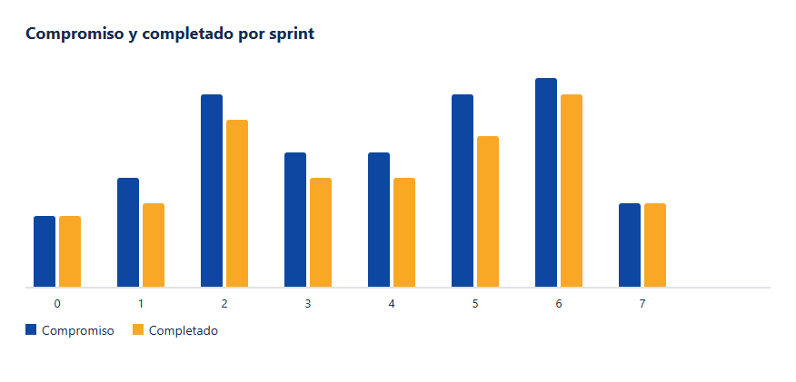

# Métricas

Al cerrar cada sprint se anotaron cuatro números: lo planificado al empezar, lo completado, el carry over que pasa al siguiente y el planificado propio del sprint que viene. El compromiso real de un sprint es el planificado más lo que venía arrastrado. La tabla de abajo usa esa cuenta. No es una velocidad medida con un equipo de cinco. Es la de una persona, y por eso el techo se respetó casi siempre: cuando el compromiso pasaba de 20, algo quedaba afuera en lugar de fingir que la semana tenía más días.

| Sprint | Fechas | Planificado | Arrastre | Completado | Carry over |
| --- | --- | --- | --- | --- | --- |
| 0 | 2 al 13 de marzo | 8 | 0 | 8 | 0 |
| 1 | 16 al 27 de marzo | 13 | 0 | 10 | 3 |
| 2 | 30 de marzo al 10 de abril | 20 | 3 | 20 | 3 |
| 3 | 13 al 24 de abril | 13 | 3 | 13 | 3 |
| 4 | 27 de abril al 8 de mayo | 13 | 3 | 13 | 3 |
| 5 | 11 al 22 de mayo | 20 | 3 | 18 | 5 |
| 6 | 25 de mayo al 5 de junio | 20 | 5 | 23 | 2 |
| 7 | 8 al 19 de junio | 8 | 2 | 10 | 0 |

La lectura es simple. El sprint 0 cerró limpio porque el alcance era chico y técnico. El sprint 1 dejó 3 puntos de marco visual. A partir del sprint 2 el arrastre de la inscripción a la mesa se mantuvo en 3 hasta que el sprint 6 lo absorbió junto con el filtro y los mensajes proactivos. El sprint 5 es el único que baja de forma visible: el motor se cerró y los avisos solos se dejaron para el sprint siguiente, a propósito. El sprint 6 completó más de lo planificado porque liquidó arrastre, no porque se hayan inventado puntos. El sprint 7 cerró en cero. No quedó tarjeta de producto abierta.

Conviene verificar dos filas a mano, porque el resto se lee igual.

En el sprint 5 el planificado fue 20 y el arrastre que venía del sprint 4 fue 3. El compromiso era 23. Se completaron 18. La diferencia, 5, es el carry over: 3 del filtro de envíos, que se pasó de nuevo, y 2 del primer tramo de mensajes proactivos, que quedó dentro de la tarjeta de recordatorios. Esa tarjeta no se pasó a Hecho. El sprint 6 la recibió.

En el sprint 6 el planificado fue 20 y el arrastre fue 5. El compromiso era 25. Se completaron 23. Quedaron 2, la redacción del destino de publicación. El sprint 7 los sumó a su planificado de 8 y cerró 10, con carry over 0. Completar más que el planificado propio no es velocidad de más: es arrastre que por fin se liquidó.

No se dibuja un burndown diario. Con una sola persona, la curva de todos los días es un serrucho que no enseña nada: un día no se toca el tablero y al día siguiente se cierran dos tarjetas. La unidad de medida que se puede defender es el sprint. El gráfico muestra, para cada uno, la barra del compromiso (planificado más arrastre) y la barra de lo completado. Donde la segunda es más baja, ese resto es el carry over de la columna de la tabla.

La velocidad útil, mirando solo lo completado, se movió entre 8 y 23 puntos, con la mayoría de los sprints de producto entre 13 y 20. Eso coincide con la capacidad que se había escrito el 2 de marzo. No hizo falta corregirla a mitad de camino. Lo que sí hizo falta fue animarse a dejar carry over en vez de estirar el sprint “hasta el domingo”.
