# Anexo I. Manual de uso

Las capturas de este anexo salen del entorno local. Los textos de botón coinciden con el producto de junio de 2026.

## Ingreso

Se abre el front. En desarrollo es `http://localhost:5173`. En el destino previsto será la URL de Vercel. Se carga el documento y la contraseña. Administración usa el usuario `admin` y la contraseña `Admin123!`. Los alumnos de demostración comparten la contraseña `Alumno123!`. El documento de cada uno está en el anexo IV. Después de entrar, el menú de la izquierda cambia según el rol. No hay botones con nombres de prueba.

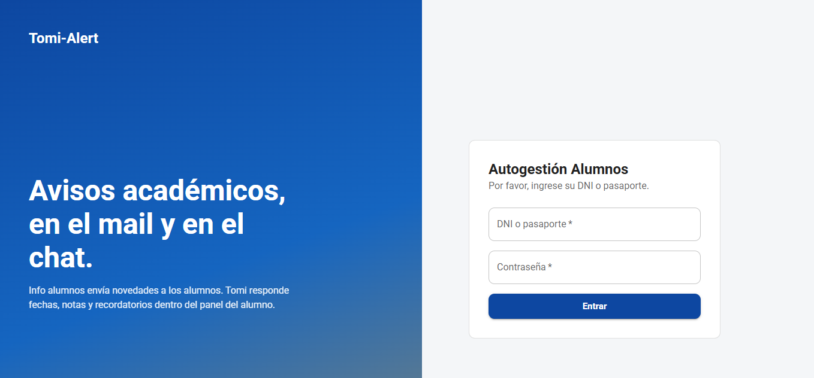

## Administración

En el inicio se elige la tarea. Mesas y parciales abre el alta y la edición de fechas. Horarios y aulas abre el plan. Avisos abre la publicación. Notas abre la carga. Envíos abre el registro. Recordatorios de mesa dispara el aviso de Tomi para quien está regular, no inscripto, y con el límite dentro de siete días. El bloque de abajo, “Para tener en cuenta”, resume el panel y los cuatro casos que conviene tener a la vista antes de empezar el recorrido.

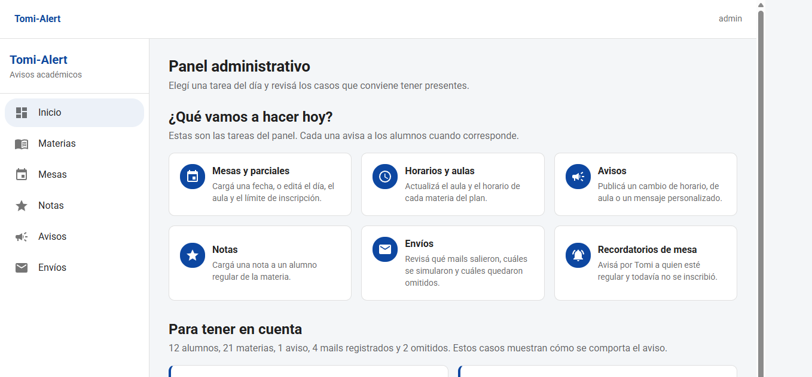

Materias muestra el plan por año. Se edita el aula y el horario, y la inscripción. El buscador pide al menos dos letras.

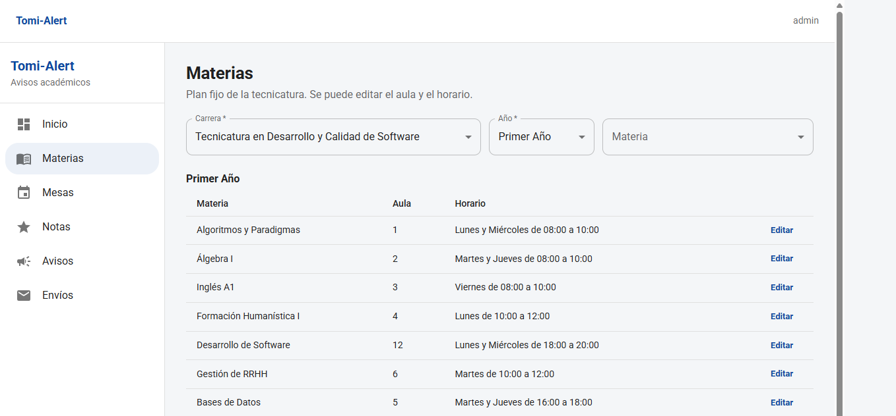

Mesas lista la materia, el tipo con mayúscula, la fecha, el límite y el aula. Nueva fecha, Editar y Borrar avisan.

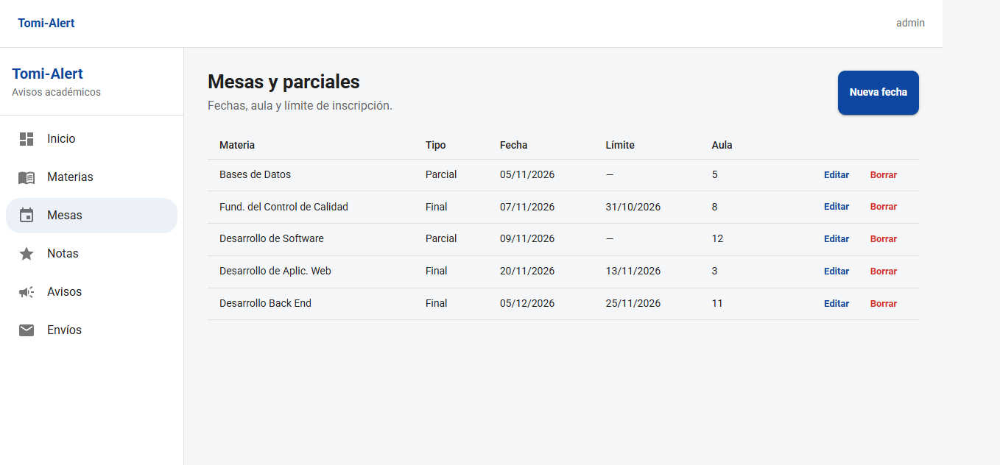

Notas exige un alumno regular. La instancia es Parcial, Recuperatorio o Final. La nota va de 0 a 10. La tabla de abajo arranca por las últimas cargas y se puede buscar por alumno, legajo o materia.

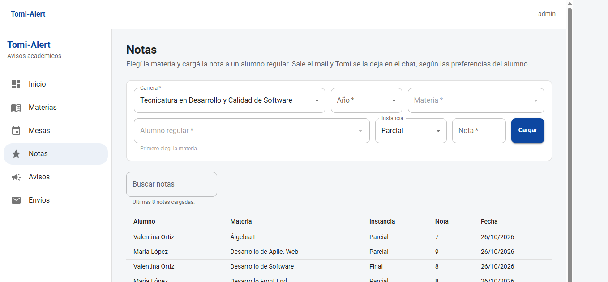

Avisos pide título, mensaje y tipo. El tipo de la figura es Aula. Publicar reparte. Reenviar mail no reescribe el chat.

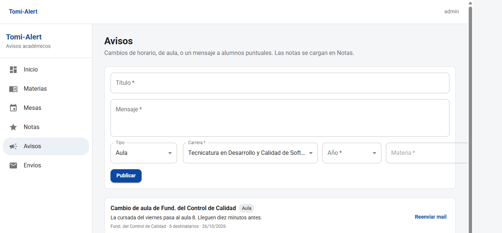

Envíos separa los selectores de las fechas. Estado, alumno, texto, desde y hasta consultan en el servidor. La figura muestra el aviso de demostración: Lucía y Luis omitidos, Martin simulado.

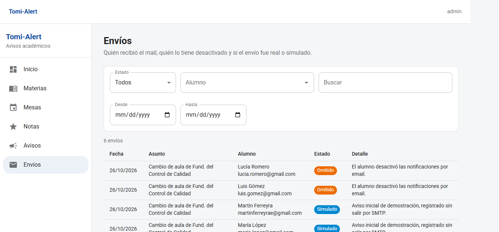

Para publicar un cambio de aula: Avisos, tipo Aula, carrera y año, materia Fundamentos del Control de Calidad, título y texto. Al guardar, el sistema reparte. Conviene abrir Envíos enseguida y filtrar por esa materia o por el estado.

Para cargar una nota: Notas, materia, alumno regular, instancia y valor de 0 a 10. El alumno que solo está cursando no aparece. Al guardar, el mensaje de éxito aclara que el mail y Tomi salieron según la preferencia.

Para filtrar envíos: estado, alumno (escribiendo al menos dos letras), un texto, y si hace falta un desde y un hasta. Limpiar vuelve a la lista completa. Desde y Hasta están en una fila distinta de los selectores, para que no queden pegados.

## Alumno

Mis materias muestra horario, aula y estado. En la figura, Martin cursa Desarrollo de Software y tiene Fund. del Control de Calidad regular, con la leyenda de que todavía no figura inscripto a la mesa.

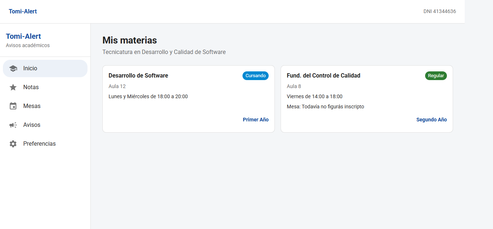

Notas muestra lo cargado. Parciales y mesas muestra la fecha, el límite y el aula de las materias de su inscripción, aunque la mesa todavía no lo tenga anotado. El tipo se lee Final o Parcial. Avisos muestra lo publicado para ese alumno. Preferencias tiene dos interruptores, independientes.

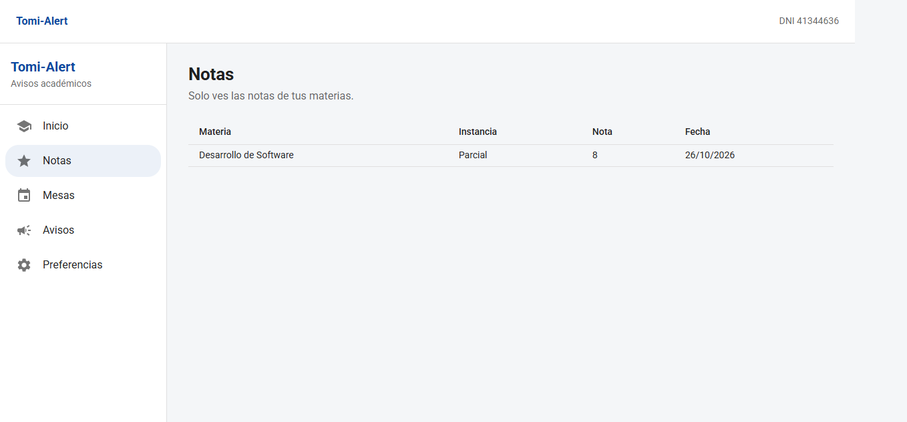

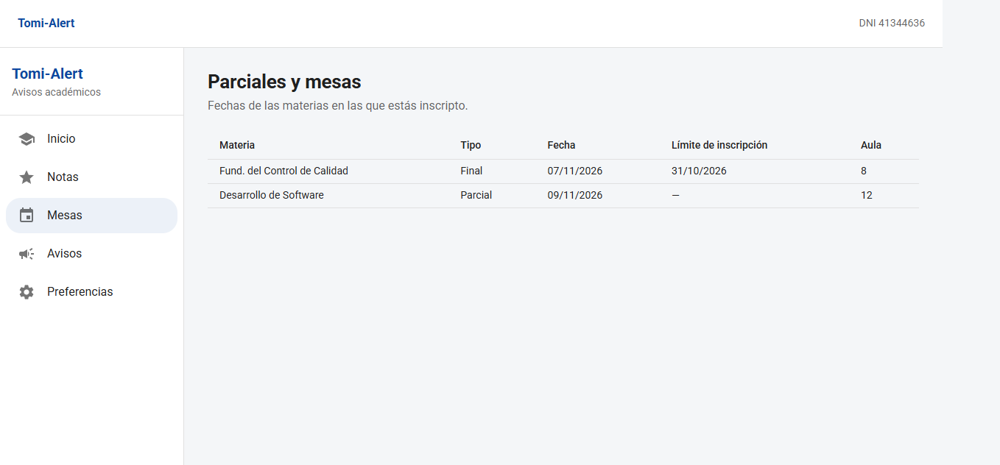

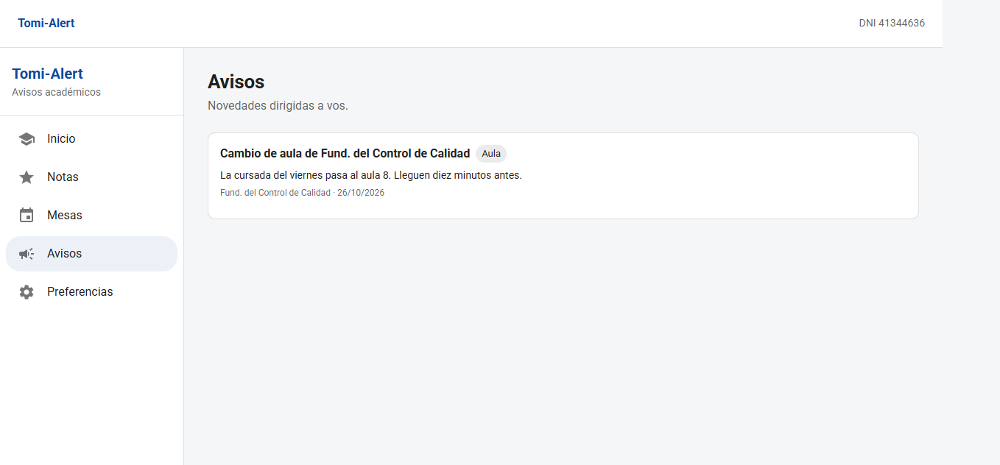

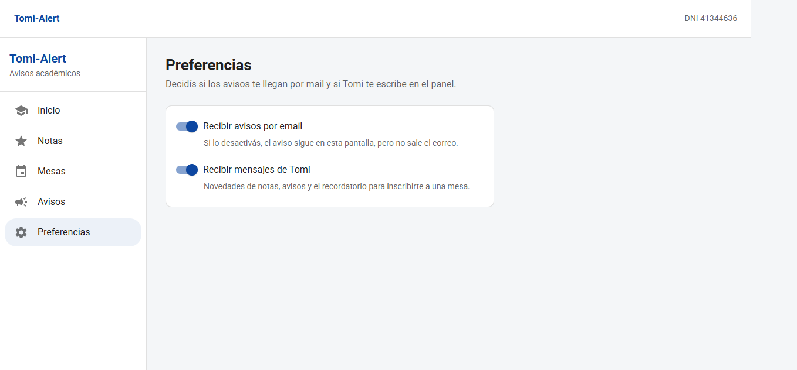

Tomi se abre con el botón inferior. Se puede tocar una respuesta rápida o escribir. Si la pregunta no nombra la materia y hay varias, Tomi pregunta. La respuesta siguiente usa esa materia. En la figura, el chat ya trae la novedad de la mesa y, al pedir Notas, pregunta de cuál de las dos.

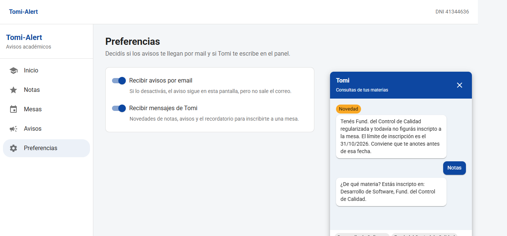

# Anexo II. Historias completas

Se transcriben en la forma en que estuvieron en el tablero. Cada una repite la historia, los criterios y el modo en que se dio por cumplida. TA-01 a TA-09 son las historias de producto y suman 52 puntos. TA-10 suma 3 y no es una pantalla: es el cierre escrito del destino de publicación. TA-00, el esqueleto, vale 8, se cerró en el sprint 0 y no se repite acá, porque no tiene un “como alumno”.

## TA-01. Iniciar sesión

Como visitante necesito iniciar sesión con DNI o pasaporte para entrar al panel que corresponde a mi rol. La administración entra con el usuario `admin`. 5 puntos. Sprint 1.

El visitante no elige el perfil en un segundo paso. El documento decide. Un DNI y un pasaporte pasan por el mismo campo, porque el documento se guarda como texto y el tipo es un dato más, no una pantalla distinta. Lucía Romero entra con el pasaporte AAB123456 y cae en el panel de alumno igual que Martin con el DNI.

Criterios. Una credencial inválida muestra error y no abre el menú. `admin` entra a `/admin`. Un alumno entra a `/alumno`. Recargar con la sesión abierta no vuelve al login. Recargar sin sesión no entra. Se cumplió en el sprint 1 y se volvió a mirar al sacar los botones de demostración, en el sprint 7, para confirmar que la pantalla de entrega seguía entrando por el mismo lugar.

## TA-02. Ver mis materias

Como alumno necesito ver mis materias, el horario y el aula. 5 puntos. Sprint 2.

La pantalla no es el plan de la carrera. Es la inscripción de esa persona. El estado se lee Cursando o Regular. Si está regular, la tarjeta dice si ya figura inscripto a la mesa o si todavía no. Martin es el ejemplo de las dos situaciones a la vez: cursa Desarrollo de Software y tiene Fund. del Control de Calidad regular sin mesa.

Criterios. No aparecen materias ajenas. El horario y el aula son los cargados, no un texto fijo de la pantalla. La marca de mesa solo se interpreta en regular. Se mostró con el panel de Martin y se contrastó con Juan Díaz, que cursa el primer año completo y no ve FCC.

## TA-03. Mantener la carga académica

Como administración necesito mantener el aula, el horario, las inscripciones, las mesas y las notas. 8 puntos. Sprint 2.

Es la historia más ancha del ciclo, y por eso vale 8. No se partió en cinco tarjetas chicas porque el dato es uno: la cursada. El aula sin la inscripción, o la nota sin la regla de regular, no se podían mostrar por separado sin mentir el criterio.

Criterios. Una nota fuera de 0 a 10 se rechaza, en la pantalla y en la API. No se carga una nota si el alumno no está regular en esa materia, aunque esté inscripto. El buscador no despliega la lista completa: pide dos letras y muestra como máximo ocho, sin distinguir tildes. Las materias del plan no se inventan desde la pantalla. El aula y el horario sí se editan. La mesa se crea con tipo, fecha y aula, y el final exige límite de inscripción. Se cumplió cuando el panel de administración pudo hacer ese recorrido y cuando una nota de 11 no entró.

## TA-04. Publicar un aviso

Como administración necesito publicar un aviso de horario, de aula o un mensaje personalizado. 5 puntos. Sprint 3.

La historia existe para que la nota no se cuele en este formulario. El texto de la pantalla lo dice. Los tipos son tres. Un aviso con materia llega a los inscriptos de esa materia. Uno personalizado llega a la lista elegida.

Criterios. Martin ve el cambio de aula de FCC. Juan, que no está en esa materia, no lo ve. No hay un tipo parcial ni un tipo final en este formulario. Reenviar vuelve a intentar el correo y no escribe otro mensaje de Tomi. Se cumplió con el aviso de la semilla y con la comparación de dos sesiones.

## TA-05. Elegir el canal

Como alumno necesito activar o desactivar el mail y los mensajes de Tomi. 5 puntos. Sprint 4.

Son dos interruptores, no uno. Apagar el mail deja el aviso en el panel y registra la omisión. Apagar Tomi deja el correo en paz y no escribe en el chat. Volver a encender no reescribe lo ya registrado: vale para el próximo aviso.

Criterios. Luis y Lucía, con el mail apagado desde la semilla, quedan omitidos. María, con Tomi apagado, no recibe el mensaje de chat. El aviso se ve igual. Se cumplió en Envíos y en los dos chats, el de Martin y el de María.

## TA-06. Preguntarle a Tomi

Como alumno necesito preguntarle a Tomi por notas, fechas, horarios y aulas. 8 puntos. Sprint 5.

Vale 8 porque cruza más de un turno y no puede inventar. La respuesta sale de las materias, las notas, las mesas y los avisos de ese alumno. Si no hay nota, lo dice. Si hay varias materias y no nombra una, pregunta y recuerda la intención. Si nombra una materia ajena, lo dice. Si tiene una sola, la asume.

Criterios. La suite automática fija las frases con materias de prueba. El panel, con Martin, tiene que citar el parcial con 8 en Desarrollo de Software y decir que no hay nota en FCC mientras esa nota no se cargue. Se cumplió cuando las dos capas dijeron lo mismo. El detalle de cada frase está en el capítulo de arquitectura, para no tener dos redacciones.

## TA-07. Que Tomi avise solo

Como alumno necesito que Tomi me avise cuando hay una novedad, o cuando se acerca el límite de una mesa que tengo regularizada y no estoy inscripto. 8 puntos. Sprint 6.

La novedad entra al chat al publicar el aviso o al cargar la nota, si Tomi está activo. El recordatorio de mesa es otro camino: no manda correo, corre a las 8, hora de Argentina, y también con el botón. La ventana es de siete días. El mismo final no se recuerda dos veces. Si Tomi está apagado, no se escribe.

Criterios. Martin recibe el recordatorio de FCC. María no. Pulsar el botón otra vez no duplica el mensaje de Martin. Se cumplió en el sprint 6. En el sprint 5 la tarjeta seguía en En curso, a propósito.

## TA-08. Enterarse de un cambio de mesa

Como alumno necesito enterarme si crean, cambian o borran una mesa o un parcial de una materia mía. 5 puntos. Sprint 6.

El arrastre de tres puntos que venía desde el sprint 2 era esta historia todavía sin cerrar. Crear, editar o borrar no es un cambio silencioso. El mensaje trae la información nueva, o la cancelación en pasado. El mail respeta la preferencia y queda en Envíos. El chat, si Tomi está activo, lleva el mismo texto.

Criterios. Editar el aula del final de FCC produce una frase con la fecha, el aula y el límite. Borrar produce la frase de eliminación. Un alumno no inscripto en la materia no está en la lista. Se cumplió al mirar el chat y Envíos después de un cambio, no al guardar el formulario solo.

## TA-09. Filtrar los envíos

Como administración necesito filtrar los envíos por estado, alumno, texto y fecha. 3 puntos. Sprint 6.

El filtro corre en el servidor. La pantalla pide páginas de cincuenta y muestra el total. Omitido no mezcla filas enviadas ni simuladas. El texto se escapa antes de usarse como búsqueda, y las fechas se leen como días de Argentina. Desde y Hasta están en otra fila, separados de los selectores, porque pegados no se podían usar.

Criterios. Con el estado Omitido, Luis y Lucía pueden aparecer y Martin, en la semilla, no. Limpiar vuelve a la lista. Un rango invertido no se consulta. Se cumplió cuando la respuesta dejó de ser “las últimas doscientas, filtradas en el navegador”.

## TA-10. Dejar escrito el destino

Como equipo necesito dejar documentado dónde va el front, dónde va la API y dónde va la base. 3 puntos. Sprint 7.

No es una historia de producto. No agrega una pantalla. El criterio es el capítulo de despliegue: Vercel para el cliente, Render para la API, Atlas para MongoDB, y la razón para no usar Heroku. Las direcciones son el destino. En esta entrega no se publicaron. Se cumplió cuando ese capítulo pudo leerse sin abrir una consola, y cuando quedó dicho que el seed no borra una base de producción por arrancar el servicio.

# Anexo III. Casos de prueba del recorrido

Cada caso dice con qué datos se entra, qué se hace y qué tiene que verse. Si el resultado es otro, no se explica con un discurso: se mira la pantalla que el caso nombra. La semilla recién cargada deja el aviso de aula de Fund. del Control de Calidad ya publicado, con sus envíos. Varios casos se pueden mostrar sobre ese aviso, sin publicar otro. Cuando el caso pide publicar o cargar, conviene decirlo en voz alta, porque escribe en la base y, si el SMTP está real, también en una casilla.

Caso 1. Login inválido. Se abre el ingreso. Se escribe un documento que existe, por ejemplo 41344636, y una contraseña que no es la de demostración. Se espera un mensaje de error y la misma pantalla. No aparece el menú del alumno ni el de administración. Recargar no tiene que abrir el panel: no hubo token.

Caso 2. Login de administración. Documento `admin`, contraseña `Admin123!`. Se espera el inicio con la pregunta de qué se va a hacer hoy, las tareas y el bloque de cosas a tener en cuenta. La barra superior dice admin. El menú tiene Inicio, Materias, Mesas, Notas, Avisos y Envíos. No tiene Preferencias ni el botón de Tomi. Ese botón es del alumno.

Caso 3. Login de Martin. Se cierra la sesión y se entra con DNI 41344636 y `Alumno123!`. Se espera Mis materias, con dos tarjetas. Desarrollo de Software en cursada, aula 12, lunes y miércoles de 18:00 a 20:00. Fund. del Control de Calidad regular, aula 8, viernes de 14:00 a 18:00, y la leyenda de que todavía no figura inscripto a la mesa. No se ve el plan de veintiún materias. El menú es el del alumno.

Caso 4. Aviso de aula. Con la semilla, el aviso “Cambio de aula de Fund. del Control de Calidad” ya está. Martin lo ve en Avisos, porque está inscripto en esa materia. Juan Díaz, DNI 42555666, cursa solo primer año y no está en FCC: al entrar con su documento, Avisos no le muestra ese cambio. Si se publica uno nuevo durante el ensayo, el tipo es Aula, la materia es FCC, y el resultado se juzga igual: lo ve quien está inscripto, no quien no.

Caso 5. Envíos de ese aviso. En administración, Envíos, se busca el asunto del cambio de aula. Martin figura simulado si la semilla no salió por SMTP, o enviado si el entorno mandó el correo de verdad. Luis Gómez y Lucía Romero figuran omitidos, con el detalle de que desactivaron las notificaciones. María López figura en el canal de mail, porque lo tiene activo, aunque tenga Tomi apagado. Son columnas distintas. El caso no pide que María tenga chat.

Caso 6. Nota que ya existe. Martin abre Tomi y escribe “qué nota tengo en desarrollo de software”. La respuesta tiene que nombrar Desarrollo de Software y el parcial con 8. La instancia en el chat puede verse en minúscula, porque el chat cita el código guardado. La tabla de Notas del alumno muestra Parcial, con mayúscula. Las dos pantallas hablan de la misma nota.

Caso 7. Nota ausente. Antes de cargar nada en el ensayo, Martin escribe “notas de fund. del control de calidad”. Tomi tiene que decir que no hay nota cargada en esa materia. No tiene que ofrecer un número cercano ni decir que está aprobada. Si el ensayo ya cargó la nota en un intento anterior, este caso se declara cubierto por el caso 8 y se dice el valor que hay. No se borra la base a escondidas para forzar la frase.

Caso 8. Carga de una nota. Administración entra a Notas, elige la tecnicatura, el año, Fund. del Control de Calidad, busca a Martin con al menos dos letras, elige una instancia y un valor de 0 a 10, y carga. El alumno que solo cursa, por ejemplo Juan en una materia de primer año que todavía no regularizó, no aparece como opción cuando esa materia se está cursando. Al guardar, el mensaje de la pantalla dice que el mail y Tomi salieron según la preferencia. Envíos tiene una fila nueva. Martin, con Tomi activo, tiene en el chat la frase de que se cargó la nota, con la instancia y el valor. María, si la nota fuera de una materia suya y se repitiera el caso con ella, tendría el mail y no el chat.

Caso 9. Recordatorio. El final de Fund. del Control de Calidad tiene el límite a pocos días de la siembra, dentro de la ventana de siete. Administración, en el inicio, genera los recordatorios. La primera vez, Martin recibe en el chat: tiene la materia regularizada, no figura inscripto, y conviene anotarse antes del límite. La segunda vez, sobre la misma mesa, no aparece un mensaje nuevo. María López, DNI 41222333, tiene esa materia regular y sin mesa, y tiene Tomi apagado: el chat de ella no recibe el recordatorio. El mail de María no es este caso. El recordatorio no sale por correo. Luis y Lucía, con Tomi activo, sí pueden tener el mensaje aunque su mail esté omitido. Facundo Molina también está regular en FCC sin mesa: si Tomi lo tiene activo, el recordatorio le corresponde.

Caso 10. Edición de la mesa. En Mesas, se edita el final de Fund. del Control de Calidad y se cambia el aula. La pantalla confirma. Quien está inscripto en la materia recibe el texto de que se modificó el final, con la fecha, el aula nueva y el límite. Envíos muestra la fila según la preferencia de mail. Si se borra esa mesa, el texto cambia de verbo: se eliminó, estaba previsto, el aula era. No dice que la mesa sigue. Conviene no borrar la mesa si el resto del guion todavía la necesita para el recordatorio. Se puede editar el aula y dejar la baja para el final, o reponer la fecha después.

Caso 11. Filtro Omitido. En Envíos, el estado se deja en Omitido y el resto se limpia. Todas las filas de la página dicen Omitido. Martin, en el juego de la semilla, no aparece, porque su aviso de demostración está simulado. Luis y Lucía sí. Si se elige Simulado, la relación se invierte. El total de arriba tiene que coincidir con lo que el filtro pidió, no con un recorte hecho a ojo sobre doscientas filas. Desde y Hasta, si se usan, se leen como días de Argentina. Una fecha invertida, con Hasta anterior a Desde, no se manda: la pantalla avisa.

Caso 12. Preferencia. Se entra como un alumno de prueba que no sea el único protagonista, para no dejar a Martin sin mail en medio del guion. Se apaga “Recibir avisos por email” y se deja Tomi como estaba. Administración reenvía el aviso o publica otro. Envíos muestra omitido para ese alumno. El aviso sigue en su panel. El chat no gana un mensaje nuevo por el reenvío: el reenvío toca el correo, no reescribe Tomi. Se vuelve a encender el mail. Los envíos viejos no cambian de estado. El próximo aviso sí puede salir.

Caso 13. Nota fuera de rango. En Notas, con un alumno regular elegido, se intenta un valor mayor que 10 o menor que 0. No se guarda. No aparece una fila en Envíos ni un mensaje de Tomi. El mismo rechazo vale para un alumno que todavía está cursando: el formulario no lo ofrece, y la API, si se la llama igual, no carga la nota.

Caso 14. Materia ajena en el chat. Martin escribe “aula de algoritmos y paradigmas”, materia en la que no está inscripto. Tomi dice que no está inscripto. No dice un aula. Si escribe algo sin sentido, dice que no está seguro y ofrece las respuestas rápidas. Si pide las notas sin nombrar materia, pregunta de cuál y, en el mensaje siguiente, acepta el nombre sin hacer repetir la pregunta.

# Anexo IV. Datos de demostración y guion de la defensa

Contraseña de todos los alumnos: `Alumno123!`. Administración: usuario `admin`, contraseña `Admin123!`.

Martin Ferreyra, DNI 41344636, legajo UIA70035. Mail y Tomi activos. Cursa Desarrollo de Software (parcial 8). Fundamentos del Control de Calidad está regular, sin inscripción. Es el protagonista del recorrido.

Luis Gómez, DNI 38999888, legajo UIA71842. Mail apagado, Tomi activo. Cursa Bases de Datos. Fundamentos del Control de Calidad regular, sin inscripción. Sirve para mostrar la omisión.

María López, DNI 41222333, legajo UIA77701. Mail activo, Tomi apagado. Está en tercer año y arrastra materias de segundo. Sirve para mostrar que el recordatorio de chat no le llega.

Juan Díaz, DNI 42555666. Cursa todo primer año.

Valentina Ortiz, DNI 43000111. Primer año regularizado y todo segundo año en curso.

Facundo Molina, DNI 41000333. Primero y segundo regularizados, tercero en curso, con mesas de segundo abiertas.

Sofía Ruiz, DNI 37888999. Desarrollo de Software e Inglés A1, en curso.

Mateo Castro, DNI 40123456. Mail y Tomi apagados. Bases de Datos y Gestión de RRHH, en curso.

Nicolás Fernández, DNI 39555111. Desarrollo Back End y Seminario Informático II, en curso.

Camila Torres, DNI 42000222. Desarrollo Front End en curso y Control de Calidad Avanzado regular.

Lucía Romero, pasaporte AAB123456. Mail apagado, Tomi activo. Fundamentos del Control de Calidad regular, sin inscripción.

Bruno Acosta, DNI 44000444. Algoritmos y Paradigmas y Álgebra II, en curso.

## Plan de la tecnicatura en la semilla

El nombre en pantalla de la materia de calidad de segundo año es “Fund. del Control de Calidad”. En la prosa de los capítulos se la llama también Fundamentos del Control de Calidad. Es la misma materia, código FCC.

| Año | Código | Materia | Aula | Horario |
| --- | --- | --- | --- | --- |
| 1 | AYPA | Algoritmos y Paradigmas | 1 | Lunes y miércoles de 08:00 a 10:00 |
| 1 | ALG1 | Álgebra I | 2 | Martes y jueves de 08:00 a 10:00 |
| 1 | INGA1 | Inglés A1 | 3 | Viernes de 08:00 a 10:00 |
| 1 | FH1 | Formación Humanística I | 4 | Lunes de 10:00 a 12:00 |
| 1 | DESW | Desarrollo de Software | 12 | Lunes y miércoles de 18:00 a 20:00 |
| 1 | RRHH | Gestión de RRHH | 6 | Martes de 10:00 a 12:00 |
| 1 | BD | Bases de Datos | 5 | Martes y jueves de 16:00 a 18:00 |
| 1 | ALG2 | Álgebra II | 2 | Miércoles y viernes de 10:00 a 12:00 |
| 1 | SEM1 | Seminario Informático I | 7 | Jueves de 18:00 a 20:00 |
| 2 | INGA2 | Inglés A2 | 3 | Viernes de 10:00 a 12:00 |
| 2 | FH2 | Formación Humanística II | 4 | Lunes de 14:00 a 16:00 |
| 2 | FCC | Fund. del Control de Calidad | 8 | Viernes de 14:00 a 18:00 |
| 2 | SEM2 | Seminario Informático II | 7 | Martes de 18:00 a 20:00 |
| 2 | FRONT | Desarrollo Front End | 9 | Lunes y miércoles de 16:00 a 18:00 |
| 2 | CCA | Control de Calidad Avanzado | 8 | Jueves de 14:00 a 18:00 |
| 2 | SEM3 | Seminario Informático III | 7 | Viernes de 18:00 a 20:00 |
| 2 | BACK | Desarrollo Back End | 11 | Martes y jueves de 18:00 a 20:00 |
| 3 | DAW | Desarrollo de Aplic. Web | 3 | Lunes y miércoles de 14:00 a 16:00 |
| 3 | TEST | Testeo Automatizado | 10 | Martes de 14:00 a 18:00 |
| 3 | INGB1 | Inglés B1.1 | 3 | Viernes de 16:00 a 18:00 |
| 3 | PF | Proyecto Final | 1 | Jueves de 18:00 a 22:00 |

Juan Díaz cursa las nueve de primer año. Valentina Ortiz tiene el primer año regular e inscripto a la mesa, y cursa las ocho de segundo. Facundo Molina tiene el primer año regular e inscripto, el segundo regular y sin mesa, y cursa las cuatro de tercero. María López tiene el primer año regular e inscripto; de tercero, DAW regular e inscripta, y TEST, INGB1 y PF en curso; de segundo, INGA2, SEM2, CCA y SEM3 en curso, FH2 y FRONT regulares e inscriptas, y FCC y BACK regulares sin mesa. El resto cursa un tramo, el que ya está en la ficha de cada uno.

Las fechas de demostración se calculan al sembrar, contadas desde ese día. Por eso en las capturas aparecen en octubre y noviembre de 2026, cerca de la entrega, y no en marzo. Un parcial de Desarrollo de Software, el final de FCC con límite a pocos días, un parcial de Bases de Datos, el final de Desarrollo de Aplic. Web y el final de Desarrollo Back End. El de FCC es el que dispara el recordatorio de Martin, Luis, María, Facundo y Lucía, cada uno según su preferencia y su inscripción.

## Guion

1. Entrar como administración.
2. En Avisos, publicar un cambio de aula de Fundamentos del Control de Calidad.
3. En Envíos, mostrar a Martin y a Luis, uno al lado del otro.
4. Salir. Entrar como Martin, DNI 41344636.
5. Mostrar el aviso y abrir Tomi.
6. Escribir “qué nota tengo en desarrollo de software”. Tiene que aparecer el parcial con 8.
7. Escribir “notas de fund. del control de calidad”. Tiene que decir que no hay nota, si todavía no se cargó en este ensayo.
8. Volver a administración. Cargar esa nota. Generar los recordatorios de mesa.
9. Volver a Martin. El chat tiene la nota y el recordatorio de inscripción.
10. Opcional: entrar como María, DNI 41222333. El recordatorio de Tomi no está. El mail, si el ensayo lo envió, es otro canal.

El ensayo se hace con la semilla recién cargada, o con la certeza de qué notas ya existen. Repetirlo sobre una base ya usada puede mostrar una nota que el guion da por ausente. En ese caso se dice lo que hay, no se fuerza el texto del paso 7.

# Anexo V. Referencias

La estructura de esta memoria sigue el índice habitual de Proyecto Final de la Tecnicatura en Desarrollo y Calidad de Software de la UNSTA: resumen, problema, roles, planificación con historias y puntos, arquitectura, ejecución por sprints, métricas, conclusiones y anexos. Se tomaron como referencia de forma dos trabajos ya aprobados por la cátedra: AppArCar (2021) y NEXO (2025). El primero fija el orden de los capítulos. El segundo muestra el nivel de detalle del tablero y del despliegue.

Las herramientas se documentan por su documentación pública de producto: React, Vite, Material UI, Express, MongoDB, Mongoose, Nodemailer, Trello, Vercel, Render y MongoDB Atlas. No se cita un paper para afirmar que un formulario funciona. Se cita la prueba.

Schwaber, K. y Sutherland, J. La guía de Scrum. Se usó el marco de sprint, tablero y retrospectiva, adaptado a un equipo de una persona, sin ceremonial de más.

El código del proyecto es la fuente de los nombres de pantalla, de los estados del envío y de las reglas de Tomi. Si esta memoria y el código se contradicen, manda el código, y la memoria se corrige.
